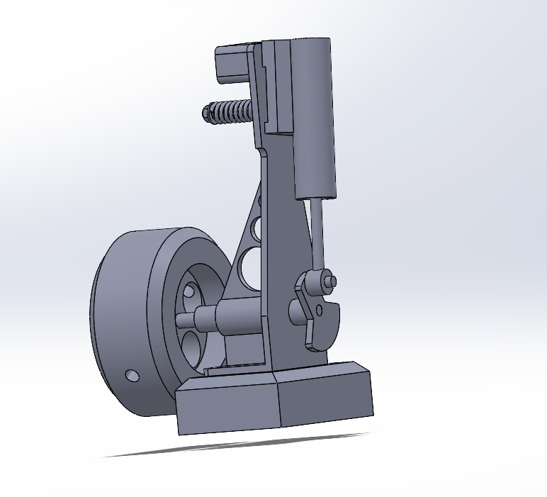

# Vertical Oscillating Steam Engine CAD Model

A SolidWorks study of part modelling, assembly constraints, and mechanism motion.

## Project summary

The portfolio dates this project to October-November 2026. It describes modelling individual mechanical parts with features including Extrude and Fillet, assembling them with constraints, and observing the complete mechanism in a motion study.

The two renders show a base, upright support, flywheel, cylinder, and connecting linkage. A typical oscillating engine combines flywheel rotation with piston travel and cylinder pivoting. The pictures do not show internal ports, valve timing, pressure capacity, or power output, so this repository makes no claims about them.

## Images

- [View one](images/steam-engine-front.png)
- [View two](images/steam-engine-opposite.png)

## How the model is organized

A useful reconstruction separates the fixed base and frame from the shaft and flywheel, crank, connecting rod, pivoting cylinder, and piston rod. Build functional sketches first, then add holes, cuts, and fillets. In the assembly, fix the base and constrain the remaining parts while preserving the rotation and pivoting needed for motion. Drive the shaft for a complete revolution and inspect collisions and mate errors. See [BUILD_GUIDE.md](BUILD_GUIDE.md).

## Challenge and learning

The portfolio identifies assembly constraints as the main challenge. The designer consulted peers and tutorials, then made iterative adjustments until the assembly and motion study worked. The project strengthened skills in parametric modelling, component relationships, troubleshooting, and independent learning.

## Evidence and next steps

This repository contains two portfolio renders and the documented narrative. The original SolidWorks parts, assembly, drawings, dimensions, and motion-study file were not supplied or verified. Future additions should include those native files, an exploded view, parts list, dimensioned drawing, interference report, and motion clip. The build guide describes a comparable demonstrator, not an exact reconstruction of undocumented details.
